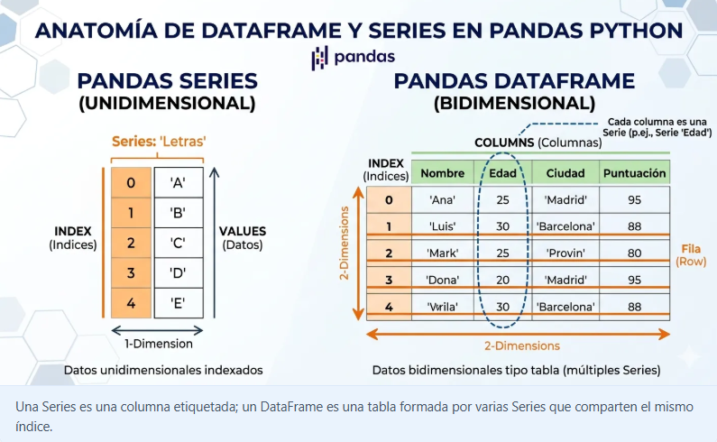
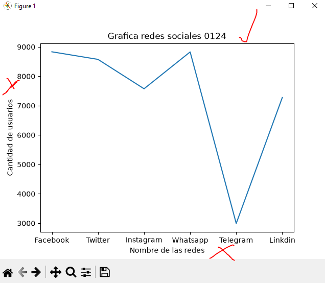
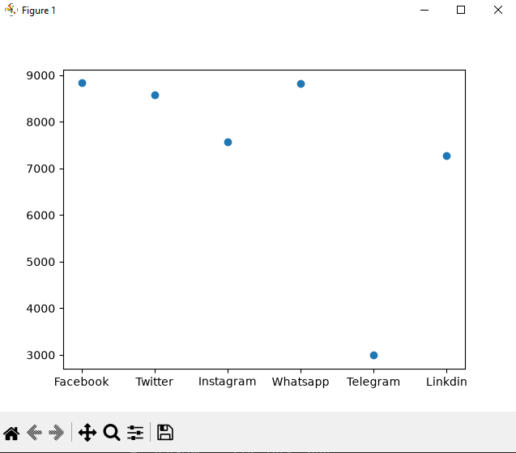
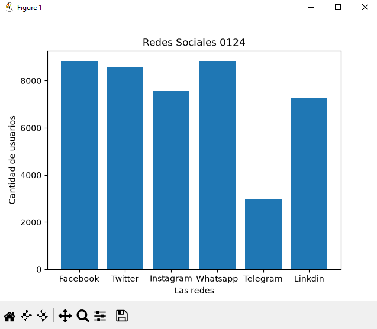
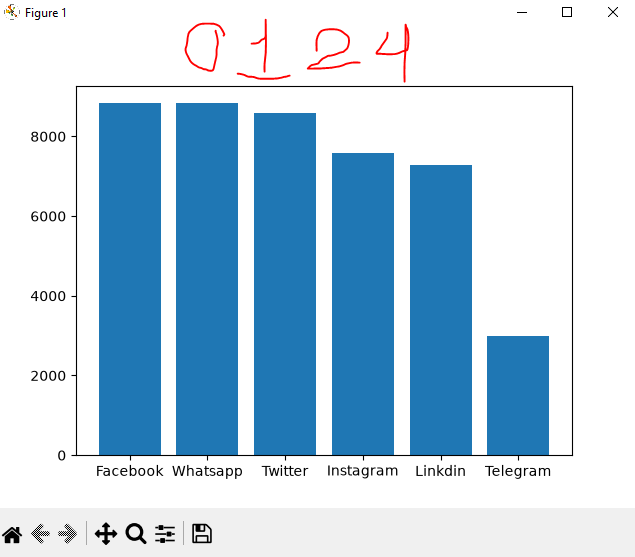
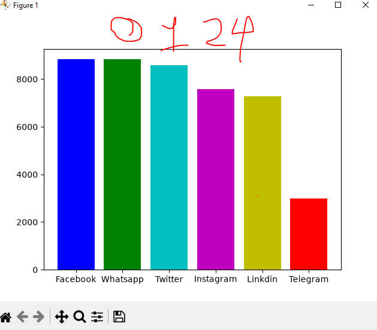
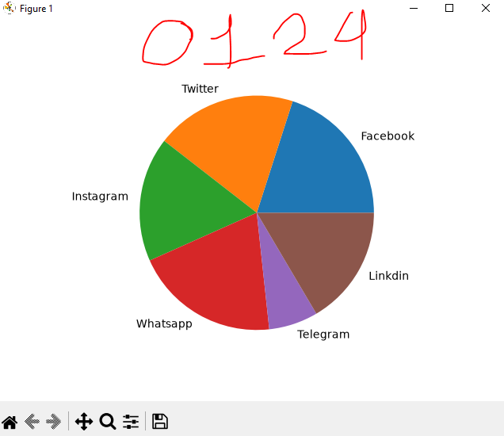

## DataFrame o marco de datos personales

## Redes sociales a nivel mundial

## Grafica de Redes sociales 

## Grafica de puntos de redes sociales

## Grafica de barras de redes sociales

## Grafica de barras ordenada

## coloreando la grafica

## grafica de o pastel o pie

